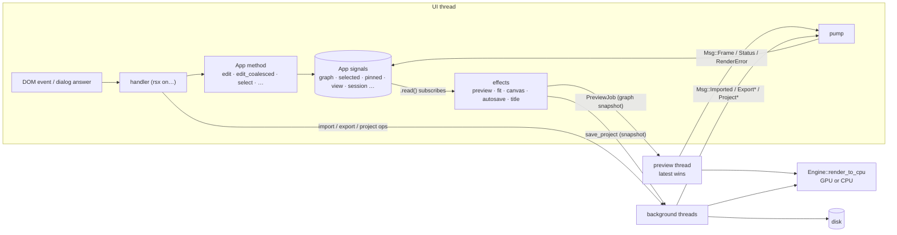

# 00 · The spine every input travels

Almost every trace in this model reuses the same machinery. It is described
once here.

## 1. Start-up wires the loop

1. `main` → `ui::launch` ([main.rs:2](../../src/main.rs#L2), [mod.rs:26](../../src/ui/mod.rs#L26)) opens a 1440×900 window with `Root`.
2. `use_services` ([mod.rs:43](../../src/ui/mod.rs#L43)) creates the `App` context, the `Worker` and its message receiver. It spawns `pump` as a UI-side task, and installs autosave.
   - `Worker::new` ([worker.rs:115](../../src/worker.rs#L115)) builds the `Engine` (GPU when it can, [mod.rs:68](../../src/engine/mod.rs#L68)) and starts the **preview thread** ([worker.rs:134](../../src/worker.rs#L134)). It warms up the GPU pipelines, then waits on a one-slot mailbox.
   - It also creates a per-session **stash** folder in the temp directory and deletes stashes older than a day ([worker.rs:402](../../src/worker.rs#L402)).
3. `Root` also registers the frame protocol handler ([platform.rs:33](../../src/ui/platform.rs#L33)). On desktop it adds an effect that keeps the window title in sync with the session ([mod.rs:63](../../src/ui/mod.rs#L63)).

## 2. State: one `App` of signals

`App` ([state.rs:109](../../src/ui/state.rs#L109)) is `Copy`, and every field is a
`Signal`. Handlers capture it, mutate signals, and return. The fields that
inputs change, grouped by role:

| Role | Signals |
|---|---|
| Document | `graph`, `history` |
| What is shown | `selected`, `selected_edge`, `pinned` (relocated output), `follow_selection`, `layout` |
| Camera | `view` (zoom, centre, fit), `viewport` |
| Feedback from the worker | `frame`, `busy`, `errors`, `global_error`, `importing`, `imports`, `seq` |
| Dialogs | `conflict`, `export`, `project_prompt`, `toast` |
| Session | `session` (Fresh / Quick / Project), `save_state`, `project_busy`, `projects_root` |

`App::displayed()` ([state.rs:351](../../src/ui/state.rs#L351)) turns `graph`,
`pinned`, `selected` and `follow_selection` into "which node output does the
image view show, and whose controls are drawn over it". The image view
memoizes it as `disp` ([image_view.rs:42](../../src/ui/image_view.rs#L42)).

## 3. Changing the document: `edit`, `edit_coalesced`, undo

- **`App::edit(f)`** ([state.rs:190](../../src/ui/state.rs#L190)) is one undo step. It pushes a clone of the graph (capped at 60 steps, and it clears redo, [state.rs:179](../../src/ui/state.rs#L179)), runs `f` on the graph, then `after_edit`.
- **`App::edit_coalesced(key, f)`** ([state.rs:199](../../src/ui/state.rs#L199)) handles continuous gestures (slider, handle drag). Edits with the same key within one second share one undo step. `App::set_param` uses it with the key `"node:param"` ([state.rs:217](../../src/ui/state.rs#L217)).
- **`after_edit`** ([state.rs:304](../../src/ui/state.rs#L304)) scans every node for a **size conflict** (a combining node with two inputs of different definite sizes) and sets `App.conflict`. That opens the "Different input sizes" dialog (trace in [02-graph-view.md](02-graph-view.md#size-conflict)).
- **`undo` / `redo`** ([state.rs:262](../../src/ui/state.rs#L262), [state.rs:274](../../src/ui/state.rs#L274)) swap whole graph snapshots and repair the selection and the relocated output. They do **not** call `after_edit` ([finding 2](findings.md#finding-2)).
- Three writers change `App.graph` **without** `edit`: node dragging ([graph_view.rs:280](../../src/ui/graph_view.rs#L280)), the GPU/CPU badge ([mod.rs:439](../../src/ui/mod.rs#L439)) and `fit_canvas_to_window` ([state.rs:323](../../src/ui/state.rs#L323)). These changes are not undoable, but they still trigger effects and autosave ([finding 3](findings.md#finding-3)).

## 4. The effects: where edits turn into work

Found by `inputtrace signals`. Each effect reruns when a signal it reads
with `.read()` changes. Reads with `.peek()` do not subscribe.

| Effect | Subscribes to | Does |
|---|---|---|
| **fit** [image_view.rs:51](../../src/ui/image_view.rs#L51) | `disp`, `viewport`, `view`, image-view `drag` | In fit mode, sets `view` so the shown extent fills the viewport. Holds while a control is dragged. |
| **canvas** [image_view.rs:70](../../src/ui/image_view.rs#L70) | `disp`, `viewport` | If the shown node is size-less, sizes the output canvas to the window (`fit_canvas_to_window(false)`). Skipped once the user has set it in this session. |
| **preview** [image_view.rs:83](../../src/ui/image_view.rs#L83) | `graph`, `backend`, `disp`, `view`, `viewport`, `dpr` | Computes the visible region at screen resolution and a key from the target's **structural hash** and the request. When the key changed, it bumps `seq`, sets `busy` and sends a `PreviewJob` with a graph snapshot. |
| **autosave** [session.rs:251](../../src/ui/session.rs#L251) | `session`, `graph` | In a project, sends `save_project` with a graph snapshot and all images the history holds. It skips the first run after opening a project. |
| **title** [mod.rs:63](../../src/ui/mod.rs#L63) | `session` | Window title (desktop). |

The preview key ([image_view.rs:107-120](../../src/ui/image_view.rs#L107)) makes
"edits that don't change the picture" free. Moving a node, or editing a
branch that does not feed the target, changes `graph` and reruns the
effect, but it produces the same key, so nothing is rendered.

## 5. The worker and its threads

| Job | Started by | Runs on | Answers with |
|---|---|---|---|
| Preview | preview effect → `Worker::preview` [worker.rs:159](../../src/worker.rs#L159) | the preview thread, one-slot mailbox: newer jobs replace older ones | `Msg::Status`, `Msg::Frame` (maybe a quarter-resolution provisional frame first, [worker.rs:196](../../src/worker.rs#L196)), `Msg::RenderError` |
| Import | `start_imports` → `Worker::import` [worker.rs:242](../../src/worker.rs#L242) | a new thread (`run_background`, [worker.rs:417](../../src/worker.rs#L417)) | `Msg::Imported` |
| Export | export dialog → `Worker::export` [worker.rs:280](../../src/worker.rs#L280) | a new thread | `Msg::ExportProgress`, `Msg::ExportDone` |
| Create / open / save / share project | session functions → [worker.rs:327-390](../../src/worker.rs#L327) | a new thread each | `Msg::Project*` |

Cancelling a preview is implicit. `run_preview` checks
`latest != seq` at every node and kernel ([worker.rs:182](../../src/worker.rs#L182),
[engine/mod.rs:201](../../src/engine/mod.rs#L201)). Exports have explicit cancel flags
([worker.rs:392](../../src/worker.rs#L392)). On the web, `run_background` runs the
same closures as cooperative tasks.

## 6. The return path: `pump`

`pump` ([mod.rs:128](../../src/ui/mod.rs#L128)) is the only consumer of worker
messages. Each arm writes signals, which re-render the components that
read them:

| Msg | Arm | Effect on state |
|---|---|---|
| `Frame` | [mod.rs:134](../../src/ui/mod.rs#L134) | Accepts the frame if it is newer (or replaces a provisional frame of the same seq). Publishes it via `platform::frame_url`, sets `frame`. When final and latest, clears `busy` and errors. |
| `RenderError` | [mod.rs:162](../../src/ui/mod.rs#L162) | For the latest seq: an error on a node (red in the graph, a box in the inspector) or a global error. |
| `Status` | [mod.rs:175](../../src/ui/mod.rs#L175) | Busy text such as "Removing background (neural network)…". |
| `Imported` | [mod.rs:180](../../src/ui/mod.rs#L180) | `finish_import` adds the node ([01-images-in.md](01-images-in.md)). |
| `ExportProgress` / `ExportDone` | [mod.rs:188](../../src/ui/mod.rs#L188), [mod.rs:199](../../src/ui/mod.rs#L199) | Progress bar. On success, closes the dialog and shows a toast. On failure, keeps the dialog open with the error. |
| `ProjectCreated` / `Opened` / `Saved` / `Shared` | [mod.rs:221-239](../../src/ui/mod.rs#L221) | Session transitions and the footer's save state ([07-projects.md](07-projects.md)). |

## 7. Rendering, briefly

All render requests end in `engine::render_to_cpu` ([engine/mod.rs:328](../../src/engine/mod.rs#L328)).
It pulls exactly the requested region through the graph (`Ctx::render`,
[engine/mod.rs:198](../../src/engine/mod.rs#L198)) and runs each node's kernels on
the GPU when possible ([engine/mod.rs:274](../../src/engine/mod.rs#L274)). Any error
is attributed to the failing node (`NodeError`). The preview thread encodes
the result as a BMP over a checkerboard ([worker.rs:452](../../src/worker.rs#L452)).
On desktop, `` fetches it from memory through the `delosframe` protocol
([platform.rs:40](../../src/ui/platform.rs#L40)). Input tracing stops here. The
engine's internal structure is covered by the code-clusters and invariants
models.
