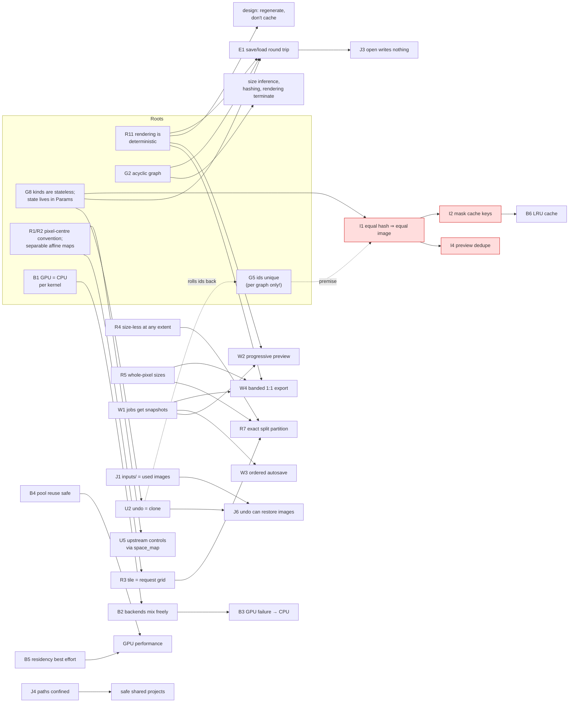

# Delos invariants

A model of Delos built from its **invariants**: the facts the code assumes are
always true, who relies on each one, and what keeps it true. The thesis being
tested is that knowing a system's invariants is the best way to understand its
structure, and to see where a human has to make a decision.

The model covers 51 invariants across six areas. Each one is described the
same way:

- **Statement**: what is assumed.
- **Depended on by**: the code that would break without it.
- **Maintained by**: the mechanism, with `file:line` links.
- **Tests**: where it is checked, if anywhere.
- **If broken**: what happens.
- **Status**: holds, fragile, or violated.

Two invariants turned out to be **violated**. Both are confirmed by failing
probe tests: see [findings.md](findings.md).

The analysis is of commit `197e30c`. Nothing in `src/` or `tests/` was changed.

## Contents

| File | Area |
|---|---|
| [01-document-model.md](01-document-model.md) | The graph: output node, acyclicity, edges, ids, images, parameters, stateless kinds, layer stacks |
| [02-geometry-and-rendering.md](02-geometry-and-rendering.md) | Node space, affine maps, tile sizes, size-less generators, whole-pixel sizes, exact splits, ROI rendering, premultiplied alpha, pyramid, determinism, errors |
| [03-backends-and-resources.md](03-backends-and-resources.md) | GPU/CPU kernel parity, backend mixing and fallback, texture pool, source residency, the expensive-result cache |
| [04-structural-identity.md](04-structural-identity.md) | The structural hash and everything keyed by it |
| [05-concurrency-and-ui.md](05-concurrency-and-ui.md) | Snapshots, latest-preview-wins, autosave ordering, bounded export, selection, undo, edit discipline, borrows, overlay mapping, Add node, session state machine |
| [06-persistence.md](06-persistence.md) | Expression round trip, error positions, `inputs/` sync, atomic saves, open-without-writing, path confinement, safe import, restorable undo, codecs |
| [findings.md](findings.md) | The two violations (with reproduction steps), plus a table of fragile spots |
| [probes/invariant_probes.rs](probes/invariant_probes.rs) | The two failing tests (copy them into `tests/` to run them) |

## How the invariants relate

Most invariants are consequences of a few **root** invariants. Each root encodes
one architectural decision. If you understand the roots, the rest of the model
follows from them.

The chains that matter most:

1. **"State lives in `Params`" (G8)** is why undo can be a plain `Graph::clone()`, saving can be "kind + params", and identity can be "hash of kind + params + inputs". A node kind that kept its own cache would break all three at once. That is why the README points to the engine `Cache` as the place where an AI-generator node should keep its results.
2. **Determinism (R11)** is why Delos can afford to *not* cache. Every preview, export band and refinement pass samples the same continuous function. The single non-deterministic node, background removal, is also the single cached one.
3. **Pixel-centre geometry, whole-pixel sizes and request-sized tiles (R1, R5, R3)** together give exact splits (R7) and seam-free 1:1 bands (W4). The "selections" feature is these three invariants applied together.
4. **Identity (G5 → I1)** is where the model breaks. The hash was meant to identify an image across *time* (the preview key and the mask cache outlive any one graph). It is computed from an id that is only unique *within* one graph, and undo and new documents roll that id back. See [finding 1](findings.md#finding-1).

## How the invariants are enforced

| Mechanism | Invariants | Comment |
|---|---|---|
| **Type system** | R2 (`Map2` cannot rotate), W1 (jobs take graphs by value), G8 (trait shape) | Rare. Most structures have public fields. |
| **API checks at mutation points** | G1, G2, G3, S1, R12, B2, B5, B6, W2, W3, U1, U2, J1–J5, E2, F1 | Hold as long as callers use the API. `Graph`'s fields are `pub`, so the API can be bypassed. |
| **By construction** | G4, G6, R4, R7, R10, B4, E1 (acyclic loading), U5 (`render` calls `input_map`) | The structure of the code makes violation hard. |
| **Runtime fallback** | B3, B5 | Violations are absorbed: the GPU becomes the CPU, a missing level is sampled on the CPU. |
| **Convention + tests** | B1, R7, R9, U4, J6 | Correct today. A change to one side breaks it until a test notices. |
| **Convention only** | R3, R5, R8, R11, G7 (clamping), U3 | **Every new `NodeKind` must uphold these, and nothing checks them.** |
| **Violated** | I1 (→ I2, I4), U6 | [findings.md](findings.md) |

## What this suggests for keeping humans in the loop

- **The roots are the decisions worth a human's attention.** G8, R1/R2, R11, G2 and G5 encode most of the architecture. A change that weakens one of them (a stateful node, a rotating node, a non-deterministic node, a direct edge write, a new kind of id) is an architectural decision, even when the diff looks local.
- **Both violations are premise drift, not careless code.** I1 was true when it was written: it was only ever compared within one graph, until undo and long-lived caches started comparing across graphs. U6 was true until nodes could have several outputs. In both cases the useful review question was *"which invariant's premise does this change alter?"*, and no test or comment pointed to the affected code. A catalogue like this one makes that question answerable.
- **The obligations with the least protection sit on the extension point.** The system is designed to be "essentially unlimited in how many types of nodes it should support". Each new `NodeKind` must uphold R3, R5, R8, R9, G7 (clamping), G8, B1 (for its kernel) and keep `input_map` consistent with `render` (U5), and none of these are checked. As a checklist:

  > A new node kind must:
  > - return tiles of exactly `req.width × req.height`;
  > - return whole-pixel sizes, or `None`;
  > - fetch only the region it needs;
  > - keep `0 ≤ c ≤ a ≤ 1`;
  > - clamp every parameter it reads;
  > - keep no per-node state outside `Params`;
  > - write the WGSL and Rust halves of its kernel to the same parameter layout, and add it to the parity tests;
  > - derive `render`'s coordinate mapping from its own `input_map`;
  > - declare its outputs, and expect `add_node`'s insert to use output 0 (see [finding 2](findings.md#finding-2)).

## Method

I read every file in `src/` and listed every test. For each assumption the code
makes, I recorded where it is used, then traced each write path to the data
involved to find what maintains it. Where a mechanism looked incomplete, I wrote
a small test that asserts the invariant ([`probes/`](probes/invariant_probes.rs)).
Both such tests fail. Consequences that go beyond what a probe shows are marked
as derived from the code in [findings.md](findings.md).
